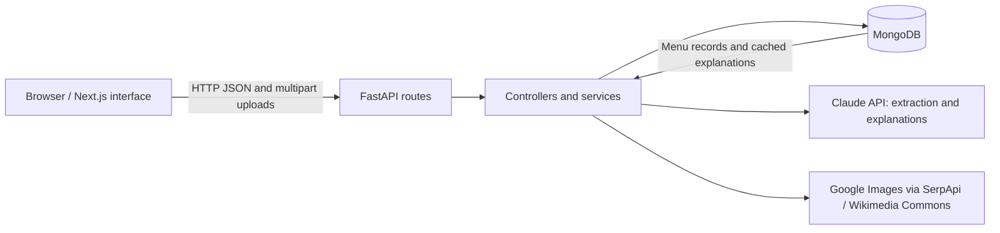

# PreBite

**Every menu, translated to home.**

PreBite helps travelers and curious diners understand unfamiliar restaurant dishes before ordering. It turns uploaded menu images and PDFs into a searchable digital menu, explains culinary terms and flavor profiles, separates restaurant information from AI interpretation, and provides reference photos to make dishes easier to recognize.

The application combines a responsive Next.js frontend, a FastAPI backend, MongoDB persistence, and Claude-powered menu analysis.

## Contents

- [Features](#features)
- [User workflow](#user-workflow)
- [Architecture](#architecture)
- [Technology stack](#technology-stack)
- [Repository structure](#repository-structure)
- [Getting started](#getting-started)
- [Environment configuration](#environment-configuration)
- [API reference](#api-reference)
- [Data and AI behavior](#data-and-ai-behavior)
- [Testing and builds](#testing-and-builds)
- [Deployment](#deployment)
- [Current limitations](#current-limitations)
- [Troubleshooting](#troubleshooting)
- [Contributing](#contributing)
- [License](#license)

## Features

### Menu ingestion and discovery

- Upload one or more JPEG, PNG, or WebP images, or a PDF menu.
- Preview selected files and optionally name the restaurant or menu.
- Extract dish names, descriptions, prices, currencies, categories, and explicitly stated ingredients, dietary labels, and allergens.
- Browse dishes by category, search menu content, and filter dietary labels.
- Review extraction confidence and correct dish information when needed.
- Revisit menu records stored in MongoDB.

### Dish explanations

- Read plain-language culinary explanations and unfamiliar ingredient or technique definitions.
- Explore flavor and spice descriptions, with restaurant facts presented separately from general culinary inferences.
- Distinguish explicitly listed ingredients from unverified inferred ingredients.
- Discover alternatives drawn from the same uploaded menu.
- View dish-matched reference photos from Google Images (when configured) or Wikimedia Commons, with source links and attribution when available.
- Reuse cached explanations and image metadata on subsequent requests.

### Scan matching and dining assistance

- Upload a cropped photo of printed menu text to find matching dishes in an existing menu.
- Review ranked matches based on extracted text, including confidence and match reasons.
- Use catalog dish views for taste bridges, sensory descriptions, and waiter phrases.
- Hear supported phrases through the browser's speech synthesis capabilities.
- Choose a home cuisine to personalize familiar culinary references.

### Account and interface

- Register and sign in with JWT-based authentication.
- Save a home cuisine preference through the user profile API.
- Switch between dark and light themes; the light palette includes readable status colors, visible borders, and keyboard focus states.
- Use layouts designed for mobile and desktop screens.

The backend also exposes community analogies, ratings, local guides, and passport stamp endpoints. These API capabilities are separate from the primary menu upload interface.

## User workflow

1. **Choose a home cuisine.** Select the culinary context you know best.
2. **Upload a menu.** Add menu pages or a PDF and optionally enter a restaurant name.
3. **Explore the extracted dishes.** Search, filter, and inspect the restaurant's original descriptions and prices.
4. **Correct extraction errors.** Update dish details when the menu was read incorrectly.
5. **Open a dish.** Read its explanation, culinary glossary, ingredients, source information, and reference photos.
6. **Compare alternatives.** Explore other dishes from the same menu or scan printed text to locate an item.
7. **Verify dietary concerns with staff.** Menu text and general recipe knowledge cannot establish allergy safety or preparation conditions.

## Architecture



The frontend calls a configurable public API URL. FastAPI routes validate requests and delegate menu processing, dish explanations, image search, and persistence to backend controllers and services. Blocking operations in the menu upload, scan, explanation, and retry routes run in worker threads.

The shared Claude client handles structured responses, media preparation, retries for transient errors, and response truncation. MongoDB stores extracted menu records and cached explanation data. The image service searches Google Images via SerpApi when configured, with Wikimedia Commons as a free fallback. Image URLs come from actual search results independently of the LLM.

## Technology stack

| Layer | Technologies |
|---|---|
| Frontend | Next.js 15, React 19, TypeScript |
| Styling | Tailwind CSS 3, scoped light-theme styles, Lucide icons |
| Backend | Python, FastAPI, Uvicorn, Pydantic |
| Database | MongoDB through PyMongo |
| AI | Anthropic Claude |
| Media processing | Pillow, pypdf, multipart uploads |
| Authentication | HS256 JWT tokens, scrypt password hashing |
| Verification | pytest, TypeScript checks, production builds |
| Delivery | Docker, Docker Compose, GitHub Actions, Python wheel and source distribution |

Use **Node.js 22** and **Python 3.12** for the documented development and deployment setup. Runtime selectors are provided in `frontend/.nvmrc` and `backend/.python-version`.

## Repository structure

```text
PreBite/
├── frontend/
│   ├── app/
│   │   ├── menu/upload/             # Menu upload interface
│   │   ├── menu/[id]/               # Digital menu and scan matching
│   │   │   └── dish/[dishId]/       # Menu dish details and explanations
│   │   ├── dish/[id]/               # Catalog/scanned dish view
│   │   ├── waiter/[id]/             # Waiter phrase view
│   │   ├── login/                   # Account interface
│   │   └── globals.css              # Shared styling and light-theme overrides
│   ├── components/                 # App state, navigation, speech, sensory UI
│   ├── lib/                        # API client, cuisine data, dish mapping
│   ├── Dockerfile
│   └── package.json
├── backend/
│   ├── app/
│   │   ├── routes/                 # HTTP endpoints
│   │   ├── controllers/            # Application operations and persistence
│   │   ├── services/               # Menu extraction, explanations, image search
│   │   ├── core/                   # Settings, authentication, LLM client, text utilities
│   │   ├── data/                   # Seed dish catalog
│   │   ├── db.py                   # MongoDB client and demonstration fallback
│   │   ├── schemas.py              # Validation and response models
│   │   └── main.py                 # FastAPI application and lifespan
│   ├── tests/
│   ├── Dockerfile
│   ├── pyproject.toml
│   ├── requirements.txt
│   └── requirements-dev.txt
├── .github/workflows/              # Frontend and backend CI
├── docs/deployment.md              # Deployment and operational guidance
├── compose.yaml
└── readme.md
```

Some backend compatibility names still contain `gemini`; the current AI implementation uses Claude. Configure the Claude variables below.

## Getting started

### Prerequisites

- Git, Node.js 22 with npm, and Python 3.12.
- MongoDB Atlas or a reachable MongoDB server for persistent account and menu workflows.
- An Anthropic API key and a model available to your account for image OCR and AI explanations.
- Docker and Docker Compose if you prefer container-based execution.

### 1. Clone the repository

```sh
git clone https://github.com/KumarDhananjaya/PreBite.git
cd PreBite
```

### 2. Configure and start the backend

Run these commands from the repository root:

```sh
cd backend
python3.12 -m venv .venv
source .venv/bin/activate
python -m pip install -r requirements-dev.txt
cp .env.example .env
```

Edit `backend/.env` with your MongoDB connection, a strong JWT secret, Claude API key, and supported model. Generate a signing secret with:

```sh
python -c "import secrets; print(secrets.token_urlsafe(48))"
```

Start the API from `backend/` so the default `.env` file is loaded from the expected directory:

```sh
uvicorn app.main:app --reload --host 127.0.0.1 --port 8001
```

On Windows, activate the virtual environment with `.venv\Scripts\Activate.ps1` in PowerShell.

| Local endpoint | Address |
|---|---|
| Health check | `http://localhost:8001/health` |
| Interactive API documentation | `http://localhost:8001/docs` |
| OpenAPI schema | `http://localhost:8001/openapi.json` |
| Versioned API | `http://localhost:8001/api/v1` |

### 3. Configure and start the frontend

In a second terminal, run from the repository root:

```sh
cd frontend
npm ci
cp .env.local.example .env.local
npm run dev
```

Open `http://localhost:3000`. The example frontend configuration points to the backend on port 8001.

### MongoDB setup

For Atlas, create a database user, allow the application host under Network Access, and copy the driver connection string into `MONGODB_URI`. Replace connection string placeholders and URL-encode special characters in credentials. Keep TLS certificate verification enabled.

Startup creates indexes and seeds the dish catalog when it is empty. Without a configured MongoDB URI, the backend provides seed data in a request-local demonstration fallback. This fallback does **not** provide durable account or menu storage. If MongoDB is configured but unavailable, the error surfaces instead of silently switching to temporary storage.

## Environment configuration

### Backend: `backend/.env`

| Variable | Purpose | Default or example |
|---|---|---|
| `APP_NAME` | API application title | `PreBite API` |
| `ENVIRONMENT` | Enables production configuration checks when set to `production` | `development` |
| `API_V1_PREFIX` | Prefix for versioned routes | `/api/v1` |
| `MONGODB_URI` | Persistent database connection | Your MongoDB connection string |
| `MONGODB_DATABASE` | Database name | `prebite` |
| `MONGO_ALLOW_INVALID_CERT` | Development-only option to permit invalid MongoDB certificates | `false` |
| `JWT_SECRET` | JWT signing secret | Generate a long random value |
| `JWT_EXPIRE_MINUTES` | Access token lifetime | `60` |
| `CORS_ORIGINS` | Comma-separated frontend origins | `http://localhost:3000` |
| `CLAUDE_API_KEY` | Anthropic API credential | Your API key |
| `ANTHROPIC_API_KEY` | Accepted alias for the Claude key | Optional |
| `CLAUDE_MODEL` | Model identifier for your Anthropic account | Set an accessible model explicitly |

The sample model identifier is a configuration placeholder; confirm model access before running live analysis. No Gemini or OpenAI API key is required by the current AI implementation.

For `ENVIRONMENT=production`, startup requires a JWT secret of at least 32 characters that is not the sample replacement value, a configured MongoDB URI, certificate verification, and explicit HTTPS CORS origins.

### Frontend: `frontend/.env.local`

| Variable | Purpose | Local value |
|---|---|---|
| `NEXT_PUBLIC_API_BASE_URL` | Browser-accessible API URL, including the version prefix | `http://localhost:8001/api/v1` |

Next.js embeds this public value during the build. Change it **before building** for deployment. Private Docker service names are not browser-accessible API addresses. Keep database credentials and AI keys exclusively in the backend environment.

## API reference

Paths below are relative to `/api/v1`, unless specified otherwise. The interactive `/docs` page contains request schemas and response details.

### Menus

| Method | Path | Purpose |
|---|---|---|
| `POST` | `/menus/upload` | Upload multipart `file` or `files`, with optional `restaurant_name` |
| `GET` | `/menus` | List saved menu summaries |
| `GET` | `/menus/{menu_id}` | Retrieve a menu |
| `GET` | `/menus/{menu_id}/dishes` | List dishes; supports `q`, `category`, and `dietary` filters |
| `GET` | `/menus/{menu_id}/dishes/{dish_id}` | Retrieve one menu dish |
| `PATCH` | `/menus/{menu_id}/dishes/{dish_id}` | Correct dish details and invalidate its explanation cache |
| `POST` | `/menus/{menu_id}/scan` | Match uploaded printed-text imagery to that menu's dishes |
| `POST` | `/menus/{menu_id}/dishes/{dish_id}/explain` | Generate or retrieve an explanation with image metadata |
| `POST` | `/menus/{menu_id}/retry` | Reprocess an uploaded or retained source file |

Example upload:

```sh
curl -X POST http://localhost:8001/api/v1/menus/upload \
  -F 'restaurant_name=Example Bistro' \
  -F 'files=@/absolute/path/to/menu.jpg'
```

### Authentication and profiles

| Method | Path | Access | Purpose |
|---|---|---|---|
| `POST` | `/auth/register` | Public | Create an account and receive an access token |
| `POST` | `/auth/login` | Public | Sign in and receive an access token |
| `GET` | `/auth/me` | Bearer token | Read the authenticated user |
| `GET` | `/users/me` | Bearer token | Read the user profile |
| `PATCH` | `/users/me` | Bearer token | Update profile fields |

Protected endpoints expect `Authorization: Bearer <access_token>`.

### Catalog, community, and passport

| Method | Path | Purpose |
|---|---|---|
| `GET` | `/dishes` | Browse the catalog with cuisine, search, and dietary filters |
| `POST` | `/dishes/scan-menu` | Analyze an uploaded menu image through the catalog workflow |
| `GET` | `/dishes/flavour-map` | Return catalog cuisine and ingredient data |
| `GET` | `/dishes/{dish_id}` | Retrieve an enriched catalog dish |
| `GET` | `/dishes/{dish_id}/taste-bridge` | Retrieve a culinary reference; accepts `home_cuisine` |
| `GET` | `/dishes/{dish_id}/insight` | Retrieve a dish insight response |
| `GET` | `/community/dishes/{dish_id}/guide` | Retrieve a local guide |
| `GET` | `/community/dishes/{dish_id}/analogies` | List community culinary analogies |
| `POST` | `/community/dishes/{dish_id}/analogies` | Add an analogy; requires authentication |
| `PUT` | `/community/dishes/{dish_id}/rating` | Record a reaction; requires authentication |
| `GET` | `/passport` | Retrieve the authenticated user's passport |
| `POST` | `/passport/stamps` | Earn a stamp; requires authentication |

`GET /health` is outside the versioned prefix. Menu routes are also exposed under `/menus` for compatibility; use `/api/v1/menus` for integrations.

## Data and AI behavior

### Extraction and grounding

Uploaded menu files are validated by their content signature and limited to **20 MiB per file**. Claude processes supported media with structured output instructions. Missing restaurant prices, ingredients, allergens, and dietary claims remain unset rather than being filled from general recipe knowledge.

If AI extraction is unavailable, a conservative fallback can parse price-bearing lines from genuine text or a PDF text layer. Arbitrary image bytes and filenames are not evidence of menu content. Scan matching depends on OCR text; without extracted text, the service returns no matches.

Explanations distinguish restaurant facts from culinary background and inferred ingredients. These distinctions support informed decisions but do not verify a restaurant's recipe, cross-contact practices, or dietary guarantees.

### Persistence and caching

MongoDB collections support dishes, users, menus, community analogies, ratings, and passport stamps. Extracted dishes are embedded in menu records. Dish explanations, reference image URLs, source links, and attribution metadata are saved in the dish's explanation cache.

Correcting a dish removes its cached explanation so subsequent requests can reflect the updated information. Existing explanation caches without image metadata are enriched when the dish explanation is requested again. A failed image search produces an empty image list while leaving the explanation usable.

Original upload bytes are **not retained by default**. The service provides file storage and bounded inline retention hooks, but no persistent upload store is configured in the default application. Retry therefore normally requires supplying the menu file again.

### Images and external services

Scanned catalog and dish explanation photos use the full dish name (and cuisine when available). Google Images is searched through [SerpApi](https://serpapi.com/google-images-api) when `SERPAPI_API_KEY` is configured in `backend/.env`. Restart the backend after adding the key. This key stays on the backend; do not set a `NEXT_PUBLIC_` key. Without a key, or when Google returns no eligible result, the service uses free Wikimedia Commons search.

Results are ranked by dish-name word overlap, accepting nearby dishes when an exact match is unavailable, and must have public HTTPS image/source URLs and pass image-size filtering when Google supplies dimensions. Generic category stock images and Unsplash results are not used. This is text-based relevance filtering, not visual verification of the restaurant's dish. A failed or unmatched search leaves the image empty. Successful results are cached in memory for six hours; empty searches are cached for one minute (up to 256 dish/cuisine queries); menu photos and source metadata are persisted. Existing saved Unsplash photos and missing catalog images are refreshed when opened. Dish details display the catalog photo even while the explanation is loading.

The frontend links to the original source and shows license/artist information when available. Google results are not assumed to carry a reuse license; consult the source. Reference presentation may differ from the restaurant's. Landing-page and demo illustrations remain separate from scanned catalog photos.

Menu files are sent to Anthropic when live AI analysis is configured. Dish names and cuisine context are sent to SerpApi/Google when configured, and dish names to Wikimedia Commons for the fallback. Review these data flows before uploading confidential material.

## Testing and builds

### Backend

From `backend/`, with the development requirements installed:

```sh
pytest -q
python -m build
```

The suite covers upload validation, menu extraction fixtures, filtering, corrections, OCR matching, explanation caching, image persistence, database behavior, and production configuration checks. External AI and image requests are mocked in unit tests.

The package build creates a wheel and source archive under `backend/dist/`, including the seed dish data. To manually verify your configured Anthropic account and model:

```sh
python test_claude.py
```

This manual check makes a live API request and may consume credits.

### Frontend

From `frontend/`:

```sh
npm run typecheck
npm run build
npm start
```

To inspect production dependency advisories:

```sh
npm audit --omit=dev
```

The frontend build includes TypeScript validation and produces standalone server output for the container image.

### Continuous integration

GitHub Actions runs frontend type checking, production builds, and a production dependency audit. Backend CI runs tests, builds Python distributions, and uploads the distributions as a workflow artifact. CI verification does not deploy either service automatically.

## Deployment

Deploy the backend and frontend as separate services with HTTPS and a persistent MongoDB database. See the [deployment guide](docs/deployment.md) for full operational details.

### Hosted services

**Backend:** install `backend/requirements.txt`, configure production environment variables, and run from `backend/`:

```sh
uvicorn app.main:app --host 0.0.0.0 --port "$PORT" --proxy-headers
```

Set `PORT` to the listening port supplied by your host. Configure the trusted reverse proxy appropriately and use `/health` for process health checks. The endpoint confirms application responsiveness; it is not a full AI or external-service readiness check.

**Frontend:** set `NEXT_PUBLIC_API_BASE_URL` to your public HTTPS API address before building, then run from `frontend/`:

```sh
npm ci
npm run build
npm start
```

### Containers

Both services have Dockerfiles that run as non-root users. The frontend image uses Next.js standalone output. Compose starts the frontend after the backend health check succeeds.

After configuring `backend/.env`, run this local example from the repository root:

```sh
NEXT_PUBLIC_API_BASE_URL=http://localhost:8001/api/v1 docker compose up --build
```

For deployment, replace the browser API address with the public HTTPS backend URL and use production backend settings. Compose does not provision MongoDB or HTTPS certificates.

## Current limitations

| Area | Current behavior |
|---|---|
| Menu access | Menu endpoints are anonymous. Knowing a menu ID permits reading and editing it; menu listing is also public. Ownership controls are not implemented. |
| Rate limiting | Application-level rate limits are not configured. Add proxy controls before exposing upload or AI endpoints publicly. |
| Upload bounds | Each menu file is bounded, but total multipart request size and file count need deployment-level limits. |
| Source retention | Original files are not retained by default; retry generally requires re-uploading. |
| Demonstration database | The unconfigured MongoDB fallback is request-local and unsuitable for persistent accounts or menu workflows. |
| AI availability | OCR, scan matching, and richer explanations depend on model access and external API availability. |
| Cached fallback content | Menu-facts-only explanations or empty image results can be cached; a later request does not guarantee an automatic external-service retry. |
| Reference photos | Search results are illustrative, may be unavailable, and are not restaurant-verified photos. |
| Dietary interpretation | Recipe inference and menu text cannot certify allergy safety, dietary suitability, or cross-contact conditions. |
| Product scope | Community and passport functionality exists in the backend; the primary frontend centers on menus and dish discovery. |

These constraints make the current application suitable for a controlled demonstration. Address access control, request limits, source storage, and operational monitoring before a public multi-user rollout.

## Troubleshooting

| Symptom | What to check |
|---|---|
| Browser cannot reach the API | Confirm the backend port and `NEXT_PUBLIC_API_BASE_URL`; restart development or rebuild after changing the frontend environment. |
| CORS request is rejected | Add the exact frontend origin, including scheme and port, to `CORS_ORIGINS`. |
| MongoDB startup fails | Check the connection string, credentials, Atlas network access, DNS, and certificate verification. |
| Accounts or menus disappear between requests | Configure MongoDB; the demonstration fallback does not retain workflow state. |
| A menu has no extracted dishes | Confirm the file is readable and the Claude key/model are valid. Image menus need live OCR; the text fallback cannot read pixels. |
| A scan returns no matches | Use a clear crop of printed dish text from the same menu and confirm OCR is available. |
| No reference photos appear | Image search may have no eligible result or may be unavailable; dish details remain usable. |
| Retry asks for another file | Default source retention is disabled. Supply the original menu with the retry request. |
| Production settings are rejected | Check JWT secret length, MongoDB configuration, HTTPS CORS origins, and certificate verification. |
| Docker cannot start | Ensure the Docker daemon is running and ports 3000 and 8001 are available. |

## Contributing

Keep changes focused and document any new environment variables, endpoints, or operational behavior. Preserve the distinction between restaurant statements and AI inferences. Add meaningful regression coverage for backend behavior, run the relevant checks, and verify interface changes in both themes and at mobile and desktop widths.

Use example environment files to document configuration. Keep real credentials, local environment files, dependency directories, and generated build artifacts out of version control.

## License

No project license file is currently included. Confirm reuse and redistribution terms with the repository owner. Third-party dependencies and referenced images retain their respective licenses.
